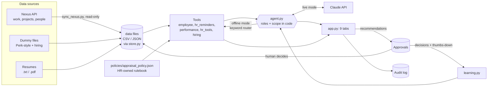
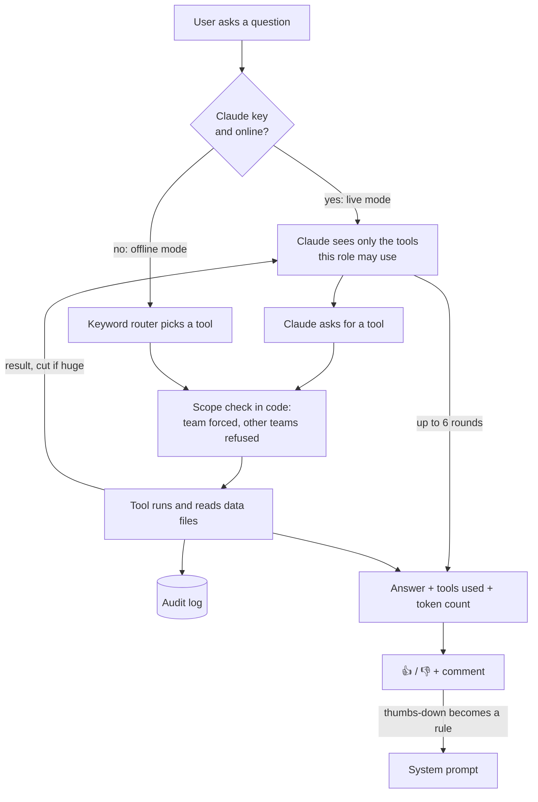
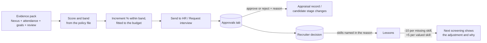
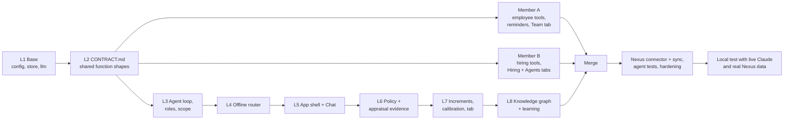

# HumaNova: the tabs, how they work and how they were built

HumaNova is an HR agent for managers, recruiters and HR. It answers from our own data, shows its sources, and never decides alone: every stage change and appraisal waits for a human in **Approvals**. (Flow charts below use Mermaid; GitHub and VS Code's Markdown preview draw them.)

## 1. The big picture



**Roles (no login in the demo):** *HR Admin* sees everything. *Manager - <team>* sees only that team, enforced in code. *Recruiter* sees hiring only. The role decides which tools Claude may call and which tabs show.

## 2. The nine tabs

| Tab | What it does | Who | Built from |
|---|---|---|---|
| 💬 **Chat** | Ask anything in plain words. Shows the answer, tokens, the tools used, 👍/👎 feedback | all | `app.py`, `agent.py` |
| 👥 **Team** | Headcount, present/leave today, who needs a supportive conversation, team table, 1:1 prep summary | managers, HR | `ui_team.py`, `tools/employee_tools.py` (Member A) |
| ⚖️ **Appraisals & HR** | Cycle status, calibration checks, increment recommendations within budget, evidence pack per person, reports, Nexus work and capacity panel | managers, HR | `ui_appraisals.py`, `tools/performance_tools.py`, `tools/hr_tools.py`, `policy.py` |
| 🧑‍💼 **Hiring** | Openings, upload CVs (non-CVs refused), anonymised screening and ranking, invite/reject emails (drafts), interview questions, "Not a fit" with a reason | recruiter, HR | `ui_hiring.py`, `tools/hiring_tools.py` (Member B), `learning.py` |
| ✅ **Approvals** | Every stage change and appraisal waits here. Approve/reject with a reason | HR (appraisals), recruiter/HR (hiring) | `app.py`, `store.py` |
| ☀️ **Daily digest** | One click: leave today and next week, attention flags, reminders, interview candidates, pending approvals | all | `agent.daily_digest` |
| 🧠 **Knowledge graph** | People, skills, projects, openings, candidates and recruiter decisions as a graph. Search "who knows RxJS?" | all | `kg.py`, `ui_graph.py` |
| 🤖 **Agents** | A map of the agents and what each is connected to, ready/offline/planned | all | `ui_agents.py` (Member B) |
| 📜 **Audit log** | The last 200 actions: who, which tool, with what, result | all | `store.audit`, `app.py` |

## 3. How a Chat question flows



If Claude is unreachable the app falls back to the offline router and says so. Claude never computes a score: scores, bands and increment % come from the tools and the policy file.

## 4. How a decision flows (Appraisals and Hiring)



## 5. Where the numbers come from

- **Nexus (read-only):** weekly tasks done, bugs fixed and reopened, on-time %, projects. `scripts/sync_nexus.py` or the sidebar button pulls what your Nexus login may read and writes the same data files the app already uses. What a login can't read (for example attendance, goals, reviews, join dates) shows as "no data", never as a made-up value.
- **Policy file:** weights, bands, increment ranges, budget, eligibility, capacity rules. HR can replace it without code changes.
- **Dummy files:** the demo story (Perk-style employees, attendance, leave, goals, reviews, hiring) from the data generators.

## 6. How it was built



Each person owned separate files, agreed function shapes in `CONTRACT.md` first, and merged branches into `Live-Copy` for testing.

## 7. Run and test

```
.venv\Scripts\streamlit.exe run app.py --server.address localhost --server.port 8788
```

Needs `.env` with `ANTHROPIC_API_KEY` (live Claude) and `NEXUS_EMAIL` / `NEXUS_PASSWORD` (Nexus sync); without them the app runs offline on the dummy data. Tests: `tests/test_agent.py`, `test_nexus_sync.py`, `test_hiring.py`, `test_employee.py`, `test_storage_and_uploads.py`. `scripts/check_live.py` tries real Claude once a key is set.

## 8. Known limits

- A Nexus login without HR view-all rights can't load attendance, leave, goals, reviews or join dates, so those parts show "no data" until HR access is granted.
- Reopened bugs need a "reopen" workflow state marked in each Nexus project.
- Roles are demo roles with no login; real sign-in and a Postgres database are the next phase.
